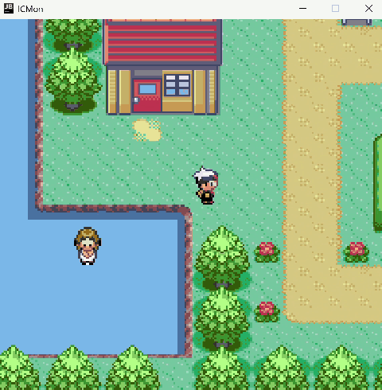
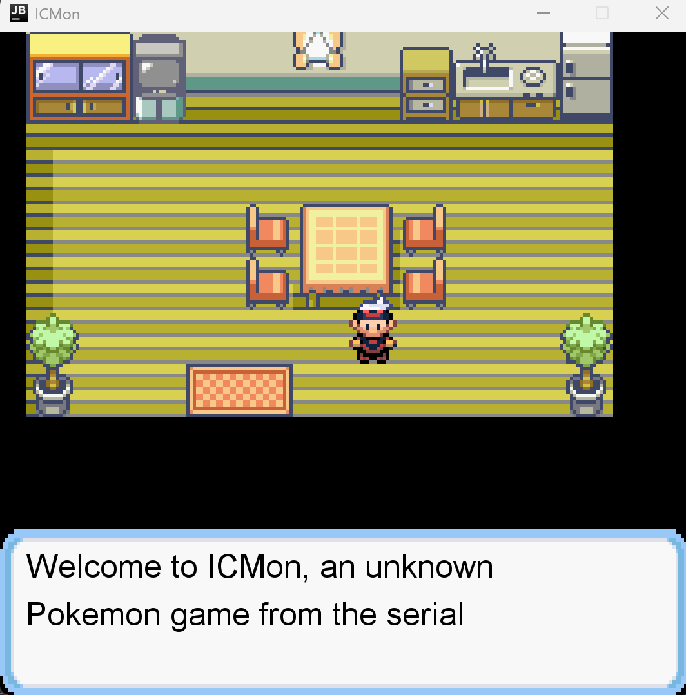
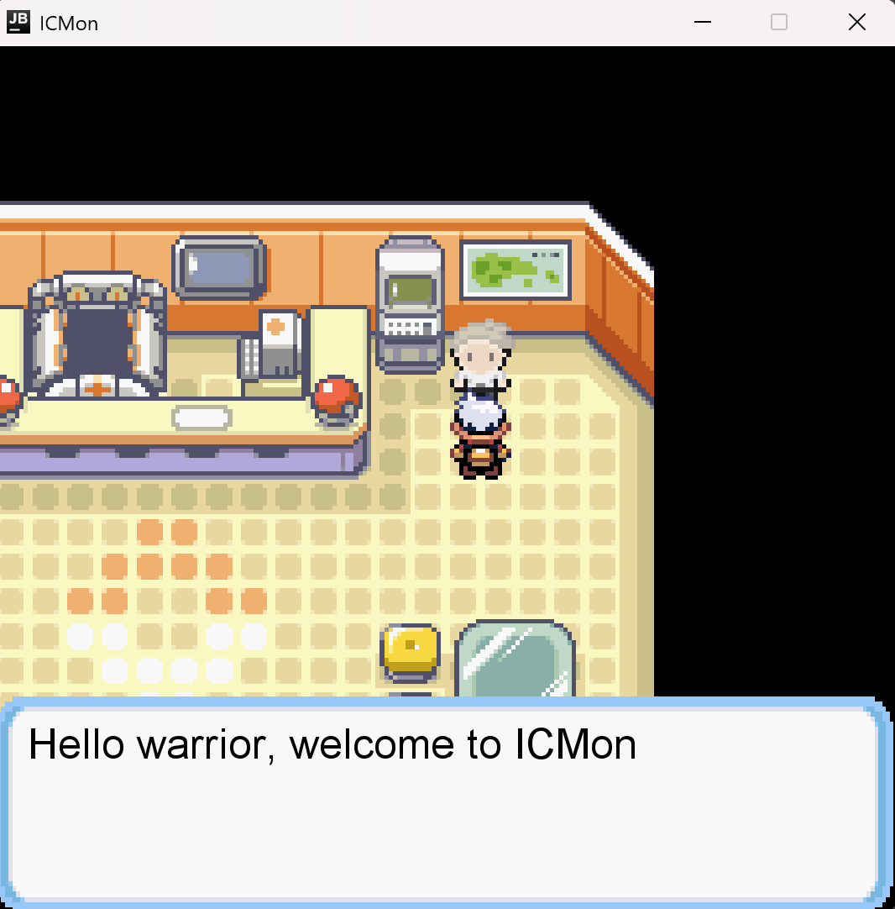
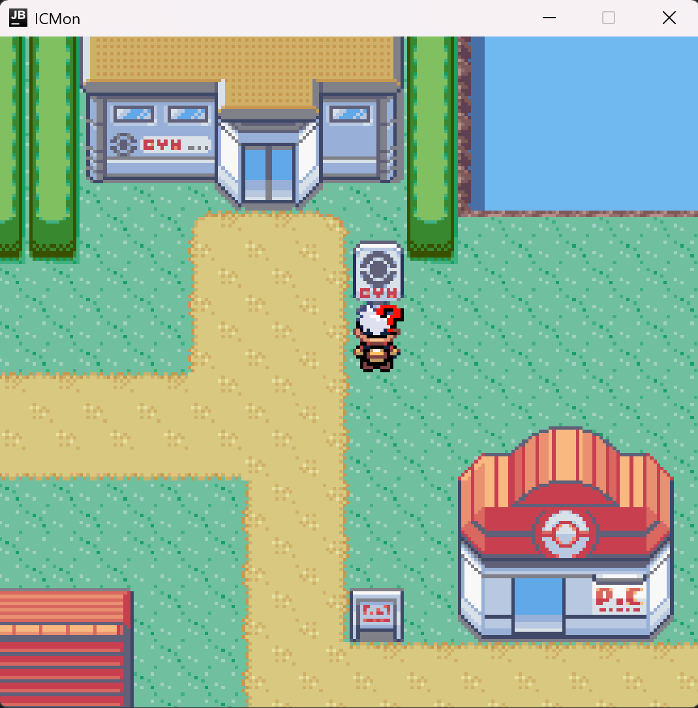
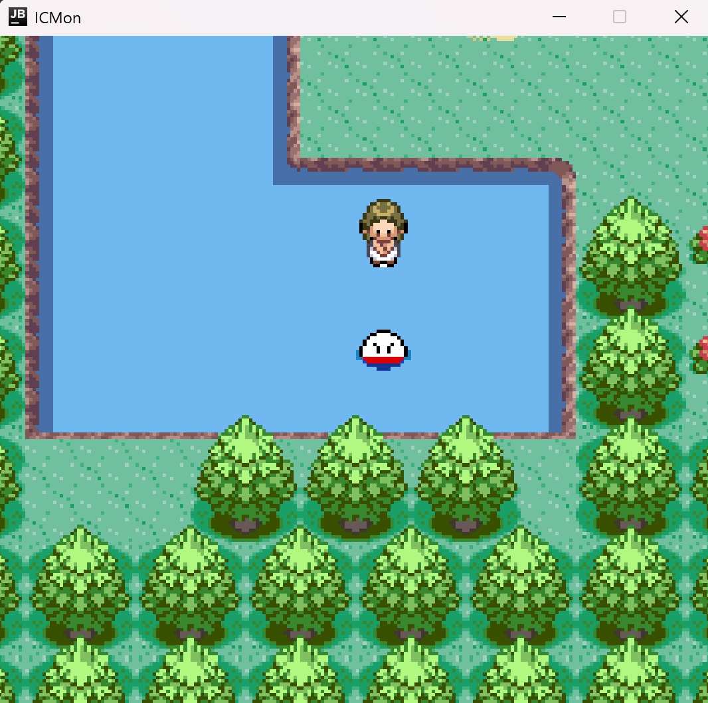
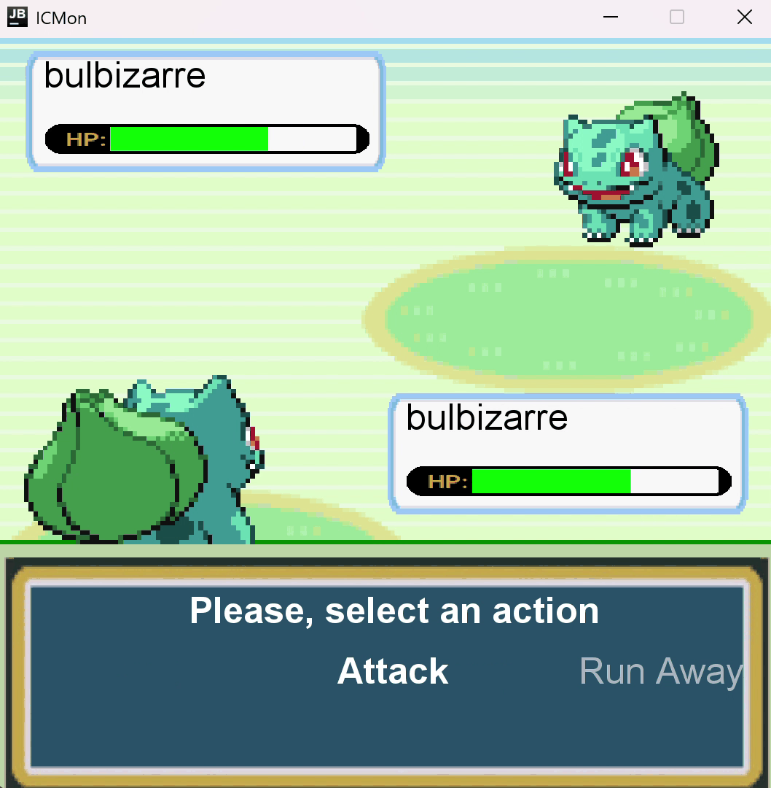

# ICMon

A turn-based creature game in Java, in the spirit of the classic Pokémon games. You start at home, meet Professor Oak in his lab, receive your first Pokémon from him, then explore the town, its shop and its arena, and fight the Pokémon you meet on the way.

Built with Badr El Berri in fall 2024 for CS-107, *Introduction to programming*, at EPFL. The course provided the game engine in `game-engine/`; the game itself is in `icmon/`.

## Screens

| Home | The lab | The town |
|:---:|:---:|:---:|
|  |  |  |
| **A route by the water** | **A fight** | |
|  |  | |

## Controls

| Key | Action |
|---|---|
| Arrow keys | Move |
| L | Talk to someone, or interact with what is in front of you |
| Space | Move a dialog on |
| Left and Right, then Enter | Pick an action in a fight |
| R | Start the game over |

## How it is built

**The story is a chain of events.** Each step of the game is an `ICMonEvent`: the introduction, the first meeting with Professor Oak, collecting an item, choosing a Pokémon, a fight, the end of the game. An event can be started, completed, suspended and resumed, and at each of those moments it runs the actions attached to it.

**Actions do the small things.** An `Action` starts a dialog, registers or removes another event, or leaves an area. Adding a step to the story means wiring an event to its actions, not adding another branch to the game loop.

**Messages cross between areas.** A `GamePlayMessage` carries what one part of the game needs another to know, for example passing a door into a new area, or suspending the current event while a fight takes over.

**A fight runs turn by turn** in `ICMonFight`, with its own screens for the fighters, the choice of action and the text in between.

The full design notes are in [CONCEPTION.md](CONCEPTION.md).

## Run it

You need JDK 17 or later.

1. Open the folder in IntelliJ IDEA as a Maven project.
2. Run `ch.epfl.cs107.Play` in `icmon/src/main/java`.

If Maven cannot resolve `submission-maven-plugin`, remove that plugin from `icmon/pom.xml`. It only packaged the hand-in for the course.

## Credits

The game engine and the project brief come from the CS-107 course staff at EPFL. Pokémon belongs to Nintendo, Game Freak and Creatures; this is a non-commercial student project.
